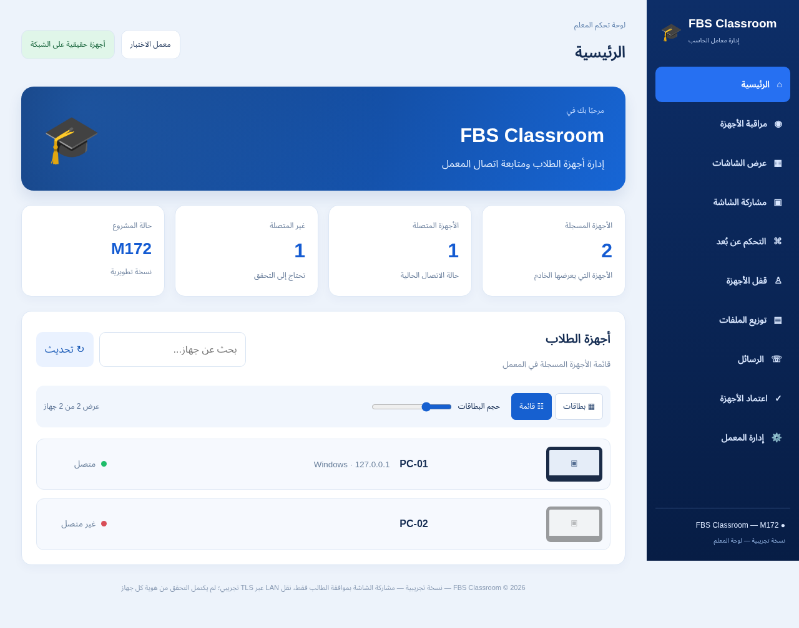

# FBS Classroom — M172

نسخة Windows x64 تجريبية غير موقّعة، بواجهة معلم محدّثة. لم يُختبر تثبيتها أو إزالتها على Windows فعلي.

- [مثبّت المعلم](https://github.com/F0500322988/FBS/raw/refs/heads/downloads/m172-preview/downloads/M172/FBS-Classroom-Teacher-M172-Setup-PREVIEW.exe)
- [مثبّت الطالب](https://github.com/F0500322988/FBS/raw/refs/heads/downloads/m172-preview/downloads/M172/FBS-Classroom-Student-M172-Setup-PREVIEW.exe)
- [المصدر](FBS-Classroom-M172-Source.zip)
- [الدليل العربي](START-HERE-AR.md)
- [تقرير الحزم](FBS-Classroom-M172-Installer-Verification.json)

نجح 1436 اختبار JavaScript، واختبار Chromium للواجهة ببيانات محاكية. تحققت أحجام وبصمات83 ملفًا مستخرجًا.

لقطة الواجهة أدناه تستخدم أجهزة وبيانات اختبار وليست إثبات تشغيل على شبكة حقيقية.

