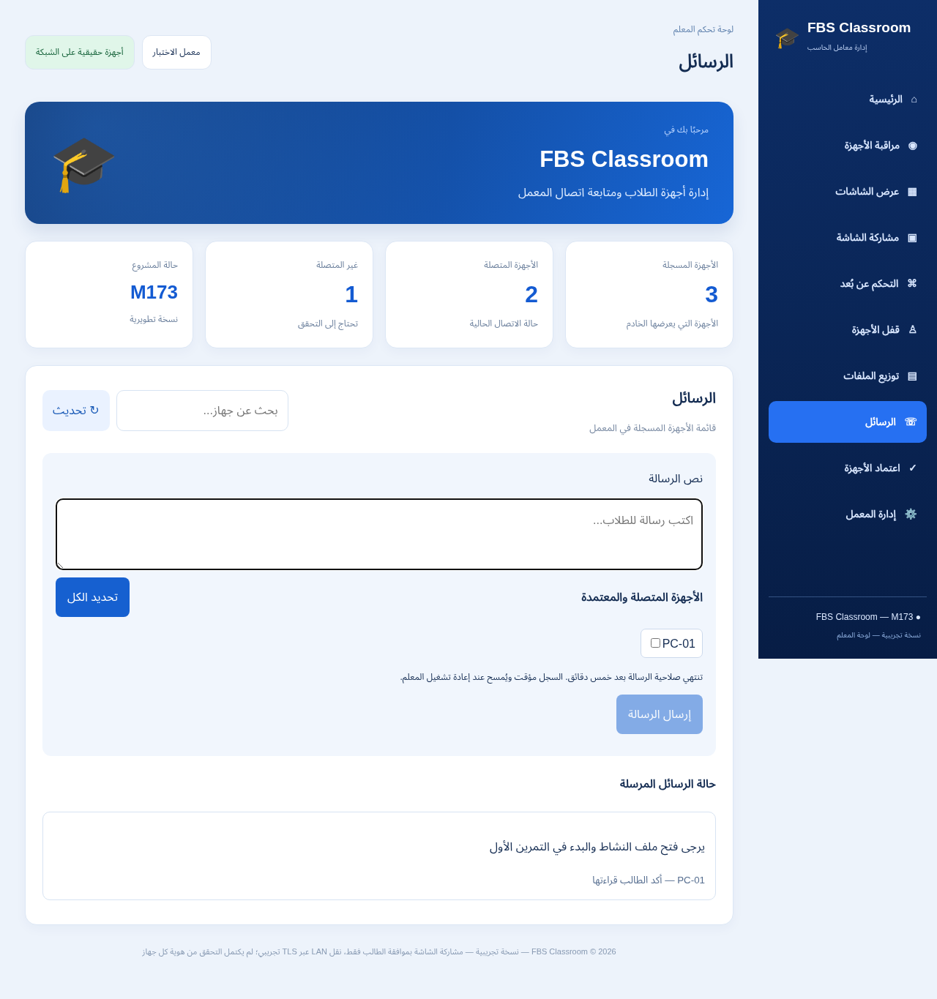

# FBS Classroom — M173 — رسائل المعلم

إصدار0.173.0-preview لنظام Windows x64. رسائل نصية للأجهزة المعتمدة، مع استلام وقراءة منفصلين. نسخة تجريبية غير موقّعة؛ تشغيل وتثبيت Windows فعلي لم يُختبرا.

- [مثبّت المعلم](https://github.com/F0500322988/FBS/raw/refs/heads/downloads/m173-preview/downloads/M173/FBS-Classroom-Teacher-M173-Setup-PREVIEW.exe)
- [مثبّت الطالب](https://github.com/F0500322988/FBS/raw/refs/heads/downloads/m173-preview/downloads/M173/FBS-Classroom-Student-M173-Setup-PREVIEW.exe)
- [المصدر](FBS-Classroom-M173-Source.zip)
- [الدليل العربي](START-HERE-AR.md)
- [تقرير الاختبارات](FBS-Classroom-M173-Validation.json)
- [تقرير الحزم والبصمات](FBS-Classroom-M173-Installer-Verification.json)

نجح 1445 اختبار JavaScript، ومسار رسائل TLS فعلي على Linux، واختبار Chromium ببيانات محاكية، و48 فحص Setup/TLS و80 NativeGate. تحققنا من85 ملفًا داخل المثبّتين. لا يزال البرنامج قيد التطوير؛ البث والقفل وتوزيع الملفات والتحكم الفعلي وmacOS غير مكتملة.

أزل النسخة التجريبية السابقة قبل تثبيت هذه النسخة في مسارها نفسه، مع إغلاق البرنامج؛ إعدادات المستخدم تبقى محفوظة. حدّث المعلم والطالب كليهما للرسائل.

الصورة التالية تستخدم بيانات اختبار، وليست دليل تشغيل Windows أو شبكة حقيقية.

