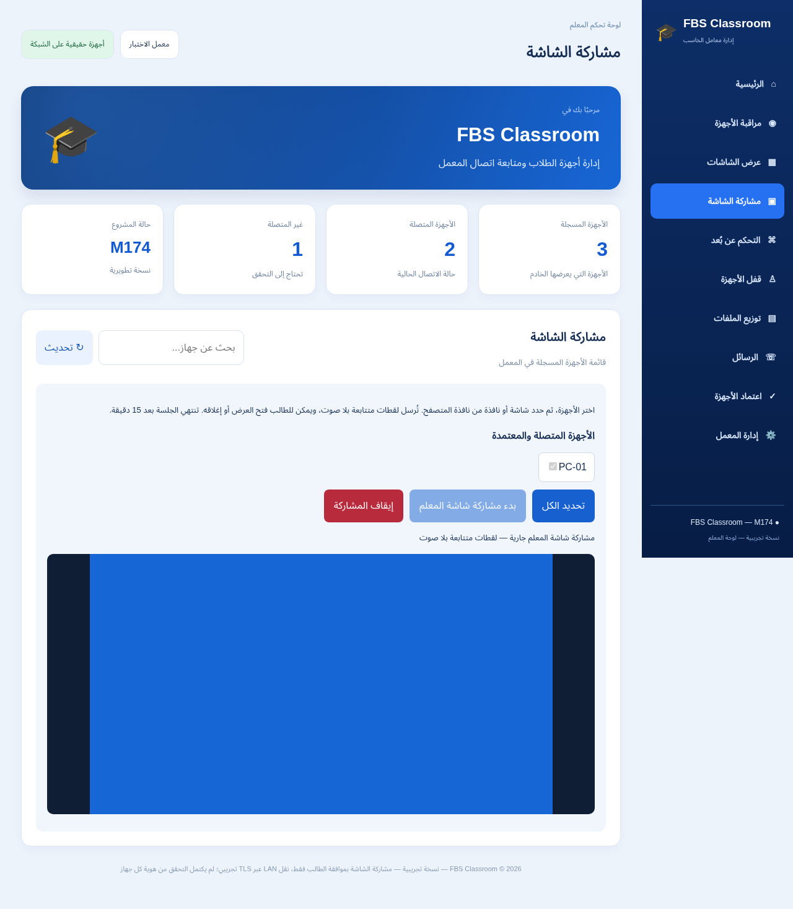

# FBS Classroom — M174 — مشاركة شاشة المعلم

إصدار0.174.0-preview لنظام Windows x64. إرسال لقطات JPEG من شاشة أو نافذة يختارها المعلم إلى الطلاب المحددين والمعتمدين عبر TLS، مع نافذة عرض اختيارية في الطالب. بلا صوت أو قفل أو تحكم فعلي.

- [مثبّت المعلم](https://github.com/F0500322988/FBS/raw/refs/heads/downloads/m174-preview/downloads/M174/FBS-Classroom-Teacher-M174-Setup-PREVIEW.exe)
- [مثبّت الطالب](https://github.com/F0500322988/FBS/raw/refs/heads/downloads/m174-preview/downloads/M174/FBS-Classroom-Student-M174-Setup-PREVIEW.exe)
- [المصدر](FBS-Classroom-M174-Source.zip)
- [الدليل العربي](START-HERE-AR.md)
- [تقرير الاختبارات](FBS-Classroom-M174-Validation.json)
- [تقرير الحزم والبصمات](FBS-Classroom-M174-Installer-Verification.json)

نجح1454 اختبار JavaScript، واختبار TLS فعلي على Linux، واختبار Chromium بمصدر Canvas واختيار شاشة محاكى، و48 Setup/TLS و80 NativeGate. تحققنا من87 ملفًا داخل المثبّتين.

المثبّتان غير موقّعين. لم يُختبر التقاط سطح مكتب Windows أو نافذة الطالب على Windows فعلي أو التثبيت/الإزالة وDPAPI أو جهازان على شبكة حقيقية. لا يزال البرنامج قيد التطوير.

أغلق التطبيقين وأزل النسخة التجريبية السابقة قبل تثبيت هذه النسخة في المسار نفسه؛ إعدادات المستخدم تبقى محفوظة. حدّث المعلم والطالب كليهما.

الصورة التالية مصدرها Canvas اختباري؛ ليست التقاطًا لشاشة Windows حقيقية.

